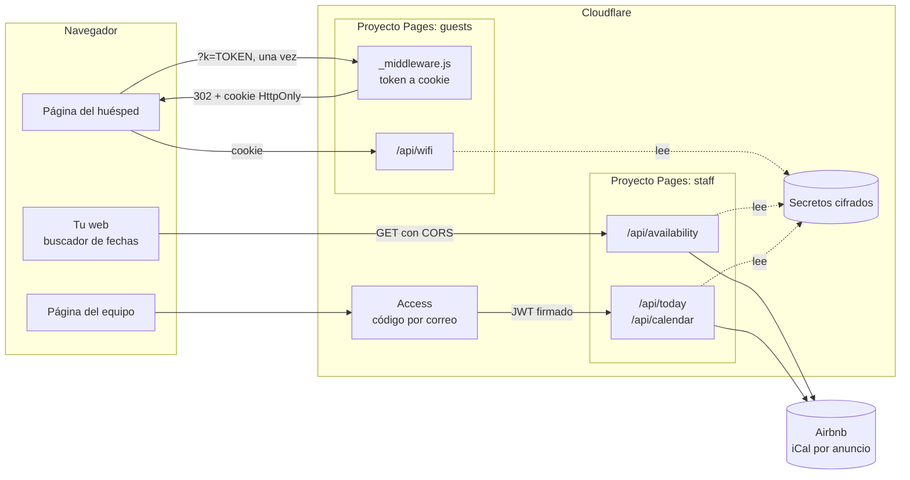

# rental-edge-functions

[](https://github.com/babylonace/rental-edge-functions/actions/workflows/ci.yml)

[](LICENSE)

*[Read in English](README.md)*

**Un backend serverless para alquileres de corta estancia, sin servidor y sin base de datos.** Lee las
reservas del calendario de cada anuncio de Airbnb, muestra al equipo de limpieza quién llega y quién
se va, responde "¿está libre en mis fechas?" en la web pública y da la clave del wifi a los huéspedes
solo a través de su enlace de check-in. Funciona con el plan gratuito de Cloudflare.

En producción en [wallaraperu.com](https://wallaraperu.com), siete departamentos en Tingo María, Perú:


## Por qué existe

Un negocio pequeño de alquiler tiene tres problemas diarios y ningún presupuesto para software:

- **Los huéspedes necesitan la clave del wifi**, pero una clave escrita en una página pública la ve cualquiera.
- **El equipo necesita ver el día de un vistazo** en varios anuncios de Airbnb: quién sale, quién entra, qué está libre.
- **Quien visita la web quiere saber qué está libre** en sus fechas antes de preguntar.

Airbnb ya tiene las reservas y Cloudflare ofrece hosting, funciones y una pantalla de acceso gratis.
Este proyecto los conecta con unas 400 líneas de JavaScript, comentarios incluidos.

## Qué incluye

| Endpoint | Quién puede usarlo | Respuesta |
|---|---|---|
| `GET /api/availability?checkin=…&checkout=…` | Tu web pública | Libre o no libre por alojamiento, nada más |
| `GET /api/wifi` | Huéspedes que abrieron su enlace de check-in | Nombre y clave del wifi |
| `GET /api/today` | El equipo, tras entrar por Cloudflare Access | Ayer, hoy y mañana por alojamiento: entrada, salida, cambio, ocupado, bloqueado, libre |
| `GET /api/calendar` | El equipo, tras entrar por Cloudflare Access | Lo mismo para los próximos 14 días |

Además, páginas mínimas para empezar: una de huésped con un botón "Show Wi-Fi", una tabla para el
equipo y un formulario de búsqueda para tu web ([`examples/`](examples/availability-search.html)).

## Inicio rápido

Solo necesitas Node 22 o superior. No hay nada que instalar.

```sh
git clone https://github.com/babylonace/rental-edge-functions.git
cd rental-edge-functions
npm test        # 41 tests
npm run demo    # cada flujo, paso a paso, con datos inventados
```

`npm run demo` muestra lo que responde cada endpoint: el wifi bloqueado sin cookie, el enlace que
deja la cookie y quita el token de la URL, el wifi con la cookie, una búsqueda de fechas, el `403`
sin Cloudflare Access y el estado del día con un JWT válido.

Para desplegarlo con tus propios alojamientos, sigue **[docs/setup.md](docs/setup.md)** (unos 30 minutos, solo planes gratuitos; en inglés).

## Cómo funciona



Los cuatro flujos, un párrafo cada uno. El recorrido completo, con diagramas de secuencia, está en
**[docs/how-it-works.md](docs/how-it-works.md)** (en inglés).

1. **Del enlace a la cookie.** El mensaje de check-in enlaza a `/?k=TOKEN`. Un middleware compara el
   token en tiempo constante, deja una cookie de 60 días firmada con HMAC-SHA256 y redirige a la misma
   URL sin el token, para que no quede en el historial. Acepta dos tokens (el actual y el anterior),
   así rotarlo no deja fuera a quien ya está alojado.
2. **Wifi.** `/api/wifi` recalcula la firma de la cookie y revisa su caducidad. Si vale, devuelve los
   datos; si no, `401`. La clave solo vive en un secreto de Cloudflare.
3. **Equipo.** Cloudflare Access pide un correo y un código de un solo uso. Después, cada función
   verifica el JWT de Access por su cuenta (firma RS256 con las claves públicas del equipo, caducidad,
   emisor y audiencia), así que un acceso mal configurado o saltado no obtiene nada.
4. **Disponibilidad.** Las fechas se validan antes de cualquier llamada de red. Los calendarios de
   Airbnb se piden en paralelo y se guardan 10 minutos en la caché de Cloudflare. Un alojamiento está
   libre si ninguna reserva se cruza con `[entrada, salida)`, así un huésped puede llegar el día que otro
   se va. La respuesta es `true`/`false` por alojamiento: fechas y enlaces de reservas nunca salen de la función.

## ¿Es eficiente?

Medido con `npm run bench` (solo CPU; la espera a Airbnb va aparte):

| Trabajo | Tiempo de CPU |
|---|---|
| Leer un calendario con mucho movimiento (90 reservas) | 0,12 ms |
| Tabla del equipo: 7 alojamientos x 14 días | 0,26 ms |
| Verificar el JWT de Access | 0,13 ms |
| Comprobar la cookie del huésped | 0,12 ms |

La petición más pesada, `/api/calendar` con siete calendarios, usa unos **1,3 ms de CPU** frente al
límite de 10 ms del plan gratuito. Los calendarios se guardan 10 minutos en caché y las claves de Access
una hora, así que Airbnb recibe más o menos una petición por anuncio cada 10 minutos, no una por visitante.

## Seguridad

- **Ningún secreto en Git.** Tokens, wifi y enlaces de calendario son variables cifradas de Cloudflare.
  El CI pasa [gitleaks](https://github.com/gitleaks/gitleaks) por todo el historial en cada push.
- **El token no se queda en ningún sitio.** Una redirección lo quita de la URL y no se guarda en la cookie;
  la cookie es `HttpOnly`, `Secure` y `SameSite=Lax`.
- **Dos cerraduras para el equipo.** Cloudflare Access delante y verificación del JWT dentro de cada
  función. Solo se acepta `RS256`, lo que bloquea los trucos `alg: none` y de confusión de claves.
- **Mínimos datos hacia fuera.** El endpoint público solo responde sí o no, y un test falla si aparece una fecha o un enlace de Airbnb.
- **Entrada estricta.** Formato y rango de fechas (de 1 a 90 noches, hasta 400 días vista, nunca en el
  pasado), solo se piden URLs de calendario de Airbnb y CORS responde solo a los orígenes de la lista.

## Tests

`npm test` ejecuta 41 tests con el runner integrado de Node: el lector de calendarios, cada estado del
día, zonas horarias, cálculo de fechas, orígenes, el flujo de la cookie, la verificación del JWT y todos
los endpoints. Usan calendarios inventados con el formato de Airbnb, un `fetch` falso que falla ante
cualquier URL inesperada (ningún test sale a la red), un reloj congelado y un par de claves RSA de usar y
tirar que hace de equipo de Cloudflare Access.

Los tests se comprobaron por mutación: romper cualquier regla de seguridad o de fechas (audiencia,
emisor, firma, caducidad, rotación del token, cruce de fechas, zona horaria, comodín de CORS) hace fallar
al menos un test. El CI los ejecuta en Node 22 y 24, y las funciones también se probaron en el runtime local de Cloudflare (Wrangler).

## El proyecto real

[Wallara](https://wallaraperu.com) alquila siete departamentos en Tingo María, en la selva alta del
Perú, a través de Airbnb. La plataforma completa es una web pública, una guía para huéspedes y un panel
para el equipo, hechos desde un solo repositorio con un sistema de diseño compartido y un único archivo
JSON de datos. Este repositorio es su backend, limpiado y hecho reutilizable: nombres de alojamientos,
dominios y cuentas son configuración, y los datos de prueba son inventados.

Lo que cambió para el negocio:

- El acceso al wifi se revoca cambiando un secreto, sin dejar fuera a quien está alojado.
- El equipo ve entradas, salidas y cambios de los siete anuncios en una sola pantalla.
- La web responde "¿está libre en mis fechas?" antes de que el visitante escriba.
- Coste de funcionamiento: cero.

**Lo que aprendí:** validar un JWT a mano (y por qué hay que fijar el algoritmo), diseñar una rotación
de token que no deja a nadie fuera, tratar las fechas como días completos en la zona horaria del
alojamiento y testear código que depende de la hora con un reloj congelado.

**Siguientes pasos:** guardar los calendarios ya leídos en Workers KV desde una tarea programada (respuestas
más rápidas y un respaldo cuando Airbnb tarda), un aviso cuando un enlace de calendario deja de funcionar y
soporte para los calendarios de Booking.com.

## Licencia

[MIT](LICENSE). El nombre y la marca Wallara no están cubiertos por la licencia.

Hecho por [babylonace](https://github.com/babylonace). AI-assisted.
