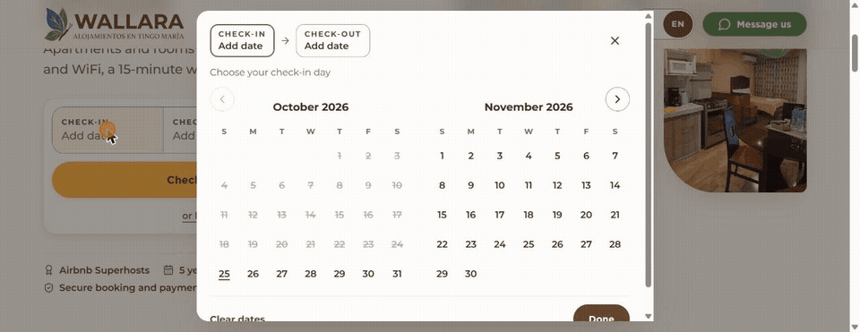

# rental-edge-functions

[](https://github.com/babylonace/rental-edge-functions/actions/workflows/ci.yml)

[](LICENSE)

*[Leer en español](README.es.md)*

**A serverless backend for short-term rentals, with no server and no database.** It reads the
bookings from each Airbnb listing's calendar, shows the cleaning team who arrives and who leaves,
answers "is it free on my dates?" on the public website, and gives guests the Wi-Fi password only
through their check-in link. It runs on Cloudflare's free plan.

In production at [wallaraperu.com](https://wallaraperu.com), seven apartments in Tingo María, Peru:



## Why it exists

A small rental business has three everyday problems and no budget for software:

- **Guests need the Wi-Fi password**, but a password printed on a public page is visible to anyone.
- **The team needs one view of the day** across several Airbnb listings: who checks out, who checks in, what is free.
- **Website visitors want to know what is free** on their dates before they ask.

Airbnb already holds the bookings and Cloudflare offers free hosting, functions and a login screen.
This project connects them with about 400 lines of plain JavaScript, comments included.

## What you get

| Endpoint | Who can use it | Answer |
|---|---|---|
| `GET /api/availability?checkin=…&checkout=…` | Your public website | Free or not free per unit, nothing else |
| `GET /api/wifi` | Guests who opened their check-in link | Wi-Fi name and password |
| `GET /api/today` | Staff signed in through Cloudflare Access | Yesterday, today and tomorrow per unit: check-in, check-out, turnover, occupied, blocked, free |
| `GET /api/calendar` | Staff signed in through Cloudflare Access | The same for the next 14 days |

Plus minimal pages to start from: a guest page with a "Show Wi-Fi" button, a staff table and a
search form for your website ([`examples/`](examples/availability-search.html)).

## Quick start

You only need Node 22 or newer. There is nothing to install.

```sh
git clone https://github.com/babylonace/rental-edge-functions.git
cd rental-edge-functions
npm test        # 41 tests
npm run demo    # every flow, step by step, with invented data
```

`npm run demo` prints what each endpoint answers:

```text
1. Guest opens /api/wifi without the cookie
  401 { "error": "locked" }
2. Guest opens the check-in link https://guide.example.com/?k=TOKEN
  302 Location: /?lang=en   (token removed from the URL)
  Set-Cookie: guest_session=1778383800.<hmac>; Max-Age=5184000; Path=/; HttpOnly; Secure; SameSite=Lax
3. The page asks /api/wifi again, now with the cookie
  200 { "ssid": "Demo-WiFi", "password": "demo-password" }
4. Public site searches 14 to 16 March (unit C has a broken calendar link)
  200 { "checkin": "2026-03-14", "checkout": "2026-03-16", "nights": 2, "units": { "A": true, "B": false }, "missing": [ "C" ] }
5. Someone calls /api/today without signing in through Cloudflare Access
  403 { "error": "forbidden" }
6. A staff member signed in through Access (the JWT is checked against the team keys)
  200 date 2026-03-10, missing: C
  unit A: yesterday stay, today turn, tomorrow stay
```

To deploy it for your own rentals, follow **[docs/setup.md](docs/setup.md)** (about 30 minutes, free plans only).

## How it works

```mermaid
flowchart LR
  subgraph Browser
    L["Your website<br/>date search"]
    G["Guest page"]
    S["Staff page"]
  end

  subgraph CF["Cloudflare"]
    direction TB
    A["Access<br/>email one-time code"]
    subgraph guests["Pages project: guests"]
      MW["_middleware.js<br/>token to cookie"]
      WIFI["/api/wifi"]
    end
    subgraph staff["Pages project: staff"]
      AV["/api/availability"]
      TD["/api/today<br/>/api/calendar"]
    end
    SEC[("Encrypted secrets")]
  end

  AIR[("Airbnb<br/>iCal per listing")]

  L -- "CORS GET" --> AV
  G -- "?k=TOKEN, once" --> MW
  MW -- "302 + HttpOnly cookie" --> G
  G -- "cookie" --> WIFI
  S --> A -- "signed JWT" --> TD
  AV --> AIR
  TD --> AIR
  WIFI -. "reads" .-> SEC
  AV -. "reads" .-> SEC
  TD -. "reads" .-> SEC
```



The four flows in one paragraph each. The full walkthrough, with sequence diagrams, is in
**[docs/how-it-works.md](docs/how-it-works.md)**.

1. **Guest link to cookie.** The check-in message links to `/?k=TOKEN`. A middleware compares the token
   in constant time, sets a 60-day cookie signed with HMAC-SHA256 and redirects to the same URL without
   the token, so it never stays in the browser history. Two tokens are accepted (current and previous),
   so rotating it does not lock out guests who are staying.
2. **Wi-Fi.** `/api/wifi` recomputes the cookie's signature and checks its expiry. Valid: the details.
   Not valid: `401`. The password lives only in a Cloudflare secret.
3. **Staff.** Cloudflare Access asks for an email and a one-time code. Each function then verifies the
   Access JWT itself (RS256 signature against the team's public keys, expiry, issuer, audience), so a
   misconfigured or bypassed login still gets nothing.
4. **Availability.** The dates are validated before any network call. Every unit's Airbnb calendar is
   fetched in parallel and cached for 10 minutes at the edge. A unit is free if no booking overlaps
   `[check-in, check-out)`, so a guest can arrive on the day another leaves. The answer is `true`/`false`
   per unit: booking dates and links never leave the function.

## Is it efficient?

Measured with `npm run bench` (CPU only; the wait for Airbnb is extra):

| Work | CPU time |
|---|---|
| Parse one busy calendar (90 bookings) | 0.12 ms |
| Staff grid: 7 units x 14 days | 0.26 ms |
| Access JWT verification | 0.13 ms |
| Guest cookie check | 0.12 ms |

The heaviest request, `/api/calendar` with seven calendars, uses about **1.3 ms of CPU** against the
10 ms limit of the free plan. Calendars are cached at the edge for 10 minutes and the Access keys for
an hour, so Airbnb sees about one request per listing every 10 minutes, not one per visitor. The cost
analysis, the complexity and what would change at a larger scale are in
[docs/how-it-works.md#efficiency](docs/how-it-works.md#efficiency).

## Security

- **No secrets in Git.** Tokens, Wi-Fi and calendar links are Cloudflare encrypted variables. CI runs
  [gitleaks](https://github.com/gitleaks/gitleaks) over the whole history on every push.
- **The token never lands anywhere.** It is stripped from the URL by a redirect and is not stored in
  the cookie; the cookie is `HttpOnly`, `Secure`, `SameSite=Lax`.
- **Two locks for staff.** Cloudflare Access in front, JWT verification inside every function. Only
  `RS256` is accepted, which blocks `alg: none` and key-confusion tricks.
- **Least data out.** The public endpoint answers only yes or no, and a test fails if a date or an Airbnb link appears in it.
- **Strict input.** Dates are checked for format, range (1 to 90 nights, up to 400 days ahead, not in the
  past) and only Airbnb calendar URLs are fetched. CORS answers only listed origins.
- **Private by default.** `noindex`, `no-referrer`, `nosniff` and `no-store` on everything private.

## Tests

`npm test` runs 41 tests with Node's built-in runner: the calendar parser, every day status, time
zones, date arithmetic, origins, the cookie flow, JWT verification and every endpoint. They use invented
calendars in Airbnb's format, a fake `fetch` that fails on any unexpected URL (so no test touches the
network), a frozen clock, and a throwaway RSA key pair that plays the Cloudflare Access team.

The tests were checked by mutation: breaking any security or date rule (audience, issuer, signature,
expiry, token rotation, overlap, time zone, CORS wildcard) makes at least one test fail. CI runs them
on Node 22 and 24, and the functions were also run in Cloudflare's local runtime (Wrangler).

## Project structure

```text
guests/                    Pages project for the guest guide
  functions/_middleware.js   token in the URL -> signed cookie -> redirect
  functions/api/wifi.js      Wi-Fi details for cookie holders
  lib/guest-auth.js          token check, cookie signing, rotation
  public/                    starter guest page and _routes.json
staff/                     Pages project for the team (behind Cloudflare Access)
  functions/api/availability.js   public: free or not free per unit
  functions/api/today.js          yesterday, today, tomorrow
  functions/api/calendar.js       next 14 days
  lib/ical.js                     calendar parser, day status, overlap, time zone
  lib/access-auth.js              Cloudflare Access JWT verification
  lib/http.js                     JSON responses, CORS origin check
  public/                         starter staff page
examples/                  search form for your public website
scripts/                   demo, benchmark, token generator
test/                      tests and invented calendars
docs/                      setup guide and how it works
```

## Configuration

| Variable | Project | Purpose |
|---|---|---|
| `GUEST_TOKEN`, `GUEST_TOKEN_PREV` | guests | Current and previous link token (`npm run token` makes one) |
| `WIFI_SSID`, `WIFI_PASS` | guests | Wi-Fi details |
| `UNITS` | staff | Unit ids, e.g. `A1,A2,B1` |
| `ICAL_<unit>` | staff | Airbnb calendar export link of each unit (secret) |
| `TIMEZONE` | staff | The property's time zone, default `America/Lima` |
| `ALLOWED_ORIGINS` | staff | Websites allowed to call `/api/availability` |
| `ACCESS_TEAM_DOMAIN`, `ACCESS_AUD` | staff | Cloudflare Access team URL and application tag |

## The real project

[Wallara](https://wallaraperu.com) rents seven apartments in Tingo María, in Peru's high jungle,
through Airbnb. The full platform is a public website, a guest guide and a staff dashboard, built from
one repository with a shared design system and one JSON data file. This repository is its backend,
cleaned up and made reusable: unit names, domains and accounts are configuration, and the test data is invented.

What it changed for the business:

- Wi-Fi access can be revoked with one secret change, without locking out the guests who are staying.
- The team sees check-ins, check-outs and turnovers for all seven listings on one screen.
- The website answers "is it free on my dates?" directly, before the visitor writes.
- Running cost: zero.

**What I learned:** validating a JWT by hand (and why the algorithm must be pinned), designing a
token rotation that does not lock anyone out, treating dates as whole days in the property's time
zone, and testing time-dependent code with a frozen clock.

**Next steps:** store parsed calendars in Workers KV from a scheduled job (faster answers and a fallback
when Airbnb is slow), an alert when a calendar link stops working, and support for Booking.com exports.

## License

[MIT](LICENSE). The Wallara name and brand are not covered by the license.

Built by [babylonace](https://github.com/babylonace). AI-assisted.
