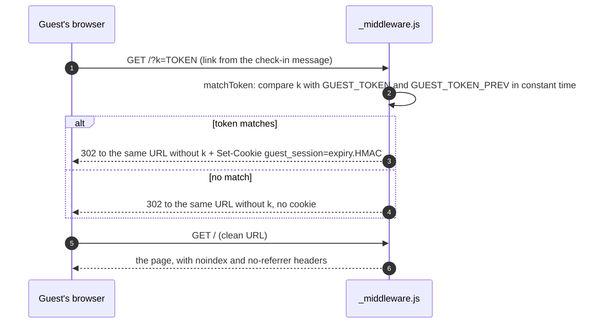
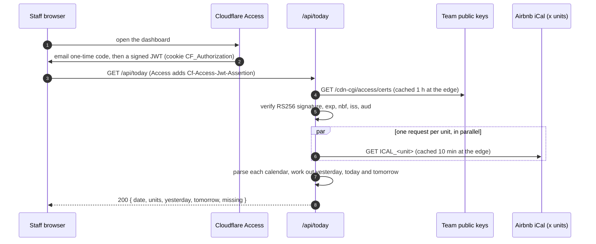
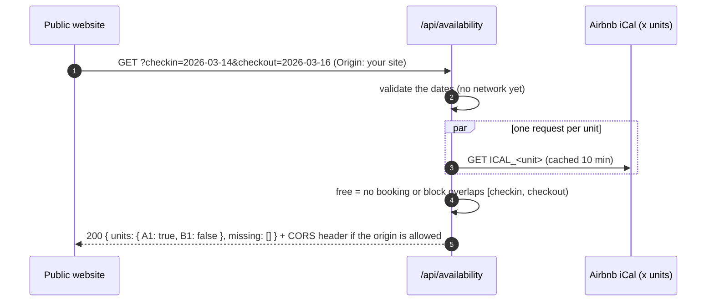

# How it works

This document walks through every request, step by step, so you can judge the logic and its cost for
yourself. For setup instructions see [setup.md](setup.md).

- [The building blocks](#the-building-blocks)
- [Flow 1: guest link to cookie](#flow-1-guest-link-to-cookie)
- [Flow 2: Wi-Fi details](#flow-2-wi-fi-details)
- [Flow 3: staff dashboard](#flow-3-staff-dashboard)
- [Flow 4: public availability search](#flow-4-public-availability-search)
- [Reading Airbnb calendars](#reading-airbnb-calendars)
- [Efficiency](#efficiency)
- [Design decisions and rejected alternatives](#design-decisions-and-rejected-alternatives)
- [Known limitations](#known-limitations)

## The building blocks

| Piece | What it is | Why it is used here |
|---|---|---|
| Cloudflare Pages | Static hosting from a Git repository | Free, global, deploys on every push |
| Pages Functions | Small JavaScript handlers in a `functions/` folder; the file path is the URL (`functions/api/wifi.js` answers `/api/wifi`) | Server logic without running a server |
| Encrypted variables | Secrets set in the Cloudflare dashboard and read as `env.NAME` | Keeps tokens, passwords and calendar links out of Git |
| Cloudflare Access | A login screen in front of a site (email one-time code) that adds a signed JWT to each request | Staff authentication without building a login |
| Airbnb iCal export | One secret `.ics` link per listing with every booking and blocked date | The booking data, without an API or a database |

Each folder (`guests/`, `staff/`) is its own Pages project with its own domain and its own secrets,
so a bug in one cannot expose the other's data.

## Flow 1: guest link to cookie

Step by step ([`guests/functions/_middleware.js`](../guests/functions/_middleware.js), [`guests/lib/guest-auth.js`](../guests/lib/guest-auth.js)):

1. The middleware runs before every guide request (`_routes.json` limits it to the pages and `/api/*`,
   so static files do not pay for it).
2. If the URL has `k`, `matchToken` rejects anything shorter than 16 or longer than 256 characters, then
   compares `SHA-256(k)` with `SHA-256(token)` for **both** configured tokens. Hashing first makes the
   comparison length-independent; comparing against every token, even after a match, keeps the timing
   the same whichever token matched.
3. A match creates the cookie value `expiry.signature`, where `signature = HMAC-SHA256(key = token, "guest-cookie:" + expiry)`.
   The token is the key, so the cookie proves the visitor once held it without containing it.
4. The redirect drops `k` whatever the result. The token never stays in the address bar, the history
   or a `Referer` header, and a wrong token gives no hint.
5. Every other response gets `X-Robots-Tag: noindex`, `Referrer-Policy: no-referrer` and `nosniff`,
   overwriting the defaults Pages adds.

**Rotation.** Move `GUEST_TOKEN` to `GUEST_TOKEN_PREV`, set a new `GUEST_TOKEN` (`npm run token`) and
send the new link from now on. Cookies signed with the previous token keep working; cookies from two
rotations ago stop working, because neither configured token can reproduce their signature.

## Flow 2: Wi-Fi details

[`guests/functions/api/wifi.js`](../guests/functions/api/wifi.js) calls `hasValidCookie`:

1. Read the `guest_session` cookie and check its shape with a strict regular expression
   (`expiry digits` `.` `URL-safe signature`). Anything else is rejected before any cryptography.
2. Reject it if the expiry is in the past. The expiry is part of the signed message, so it cannot be extended.
3. Recompute the signature with each configured token and compare in constant time.
4. Valid: `200 { ssid, password }` with `Cache-Control: no-store`. Not valid: `401 { error: "locked" }`.
   Secrets missing: `503 { error: "not-configured" }`, so a configuration mistake is visible instead of silent.

The cookie is `HttpOnly` (page scripts cannot read it), `Secure` (HTTPS only) and `SameSite=Lax`
(not sent on cross-site sub-requests).

## Flow 3: staff dashboard

Why verify the JWT if Access already blocks the page? Defence in depth. If someone found the
`*.pages.dev` address, or Access were misconfigured, the functions would still refuse to answer.
[`staff/lib/access-auth.js`](../staff/lib/access-auth.js) checks, in order of cost:

1. Configuration exists and looks right (`https://<team>.cloudflareaccess.com`, an audience tag of 16+ characters). Otherwise deny.
2. The token has three parts, decodes as JSON, and its header says `alg: RS256` with a `kid`.
   Rejecting every other algorithm blocks the classic `alg: none` and HS256 key-confusion attacks.
3. Only then fetch the team's public keys, pick the one with the same `kid` and verify the signature with WebCrypto.
4. Check the claims: not expired, not used before `nbf` (60 s clock tolerance), issued by this team, and for this application (`aud`).

`/api/calendar` does the same for the next 14 days.

## Flow 4: public availability search

[`staff/functions/api/availability.js`](../staff/functions/api/availability.js):

1. **Cheap checks first.** Both dates must match `YYYY-MM-DD`; then 1 to 90 nights, not in the past and
   at most 400 days ahead, with "today" computed in the property's time zone. Bad input costs no network request.
2. **Parallel fetch.** `loadCalendars` starts every unit's request at once (`Promise.all`), so the wait
   is the slowest calendar, not the sum. A failing calendar becomes `missing` instead of failing the whole answer.
3. **Overlap rule.** A stay is the half-open interval `[arrival, departure)`. Two stays overlap when
   `start < otherEnd && end > otherStart`. Because departure days are excluded, a guest can arrive on
   the day another one leaves.
4. **Least data.** The answer is `true`/`false` per unit. Dates, links and the calendar URLs never leave the function.
5. **CORS.** `Access-Control-Allow-Origin` is only sent for origins in `ALLOWED_ORIGINS`. A wildcard
   rule (`https://*.example.pages.dev`) matches exactly one subdomain label, so `evil-example.pages.dev`
   or `a.b.example.pages.dev` do not pass. `Vary: Origin` keeps caches from mixing answers.

This endpoint lives in the staff project so it can reuse the `ICAL_*` secrets instead of copying
them to a second place. In Cloudflare Access it gets its own application with a Bypass policy.

## Reading Airbnb calendars

[`staff/lib/ical.js`](../staff/lib/ical.js) does not use an iCal library. It only needs four fields, so it is about 30 lines:

1. **Unfold.** RFC 5545 splits long lines and starts the continuation with a space. Those breaks are
   removed first; otherwise the reservation link in `DESCRIPTION` would be cut in two.
2. **Single pass.** A small state machine walks the lines once: `BEGIN:VEVENT` opens an event,
   `END:VEVENT` closes it and keeps it only if it has both dates. Inside, it reads `DTSTART`, `DTEND`,
   `SUMMARY` (`Reserved` = booking, anything else = blocked) and the reservation link from `DESCRIPTION`.
3. **Dates stay dates.** Airbnb exports whole days (`VALUE=DATE`), so they are kept as `YYYY-MM-DD`
   strings. Strings in that format sort and compare correctly, which avoids time-zone conversions on the event side.

`dayStatus(events, day)` then answers with the first rule that applies:

| Order | Status | Rule |
|---|---|---|
| 1 | `turn` | One booking ends and another starts that day |
| 2 | `out` | A booking ends that day |
| 3 | `in` | A booking starts that day |
| 4 | `stay` | A booking covers the day |
| 5 | `blocked` | A non-booking block covers the day; `note: early-checkin` if a booking starts the next day |
| 6 | `free` | Nothing applies |

Each answer also carries `next`, the next arrival date, so the dashboard can show "free until".

## Efficiency

**CPU per request**, measured with `npm run bench` (Node 24, a laptop; a calendar with 90 bookings, which is a busy year):

| Work | Time |
|---|---|
| Parse one calendar | ~0.12 ms |
| `/api/calendar` status grid: 7 units x 14 days | ~0.26 ms |
| `/api/availability` overlap check: 7 units | ~0.001 ms |
| Guest token check (2 tokens) | ~0.04 ms |
| Guest cookie check (2 HMACs) | ~0.12 ms |
| Access JWT verification (RS256) | ~0.13 ms |

Worst case, `/api/calendar` with 7 calendars: 7 x 0.12 + 0.26 + 0.13 ≈ **1.3 ms of CPU**, against the
10 ms CPU limit of the Workers free plan. The real cost of these endpoints is waiting for Airbnb, not computing.

**Network per request**

| Endpoint | Outgoing requests | Caching |
|---|---|---|
| `/api/wifi`, middleware | 0 | Responses are `no-store` on purpose |
| `/api/availability` | 1 per unit, in parallel | iCal cached 10 min at the Cloudflare edge; the answer cached 5 min in the browser |
| `/api/today`, `/api/calendar` | 1 for the keys + 1 per unit, in parallel | Keys cached 1 h, iCal 10 min |

Within a 10-minute window, repeated searches are answered from the edge cache, so Airbnb sees about
one request per unit per 10 minutes per data centre, not one per visitor.

**Complexity.** Parsing is linear in the size of the calendar. `dayStatus` is linear in the number of
events, called units x days times (7 x 14 = 98 calls for the dashboard). With tens of events per
calendar that is trivial; with thousands it would be worth sorting the events once and searching them.

**Cost.** Everything fits the free plans: 100,000 function requests a day and Access for up to 50 users.

## Design decisions and rejected alternatives

| Decision | Alternatives considered | Why this one | Cost accepted |
|---|---|---|---|
| Read Airbnb iCal on demand | A database synced by a scheduled job; Airbnb's API | The API is not open to small hosts. A database adds sync bugs, backups and cost | No guest names; data can lag the Airbnb app by minutes or hours |
| Token in the link, then a signed cookie | A shared guide password; one account per guest | A link is what guests already receive. A password gets forwarded and never changes | Anyone holding a current link gets in until the next rotation |
| Rotate with current + previous token | One token | Rotating one token would lock out guests mid-stay | Old links keep working for one rotation |
| Verify the Access JWT in every function | Trust Cloudflare Access alone | A second, independent check if the outer one is bypassed or misconfigured | ~0.13 ms and one cached key fetch per request |
| WebCrypto, no libraries | `jose`, an iCal parser, a router | The needed parts are small and the runtime already has them | More code to read and test (covered by the tests) |
| Availability endpoint inside the staff project | A third project | Reuses the calendar secrets instead of copying them | One public route in a private project, handled by its own Access Bypass rule |
| Dates as `YYYY-MM-DD` strings | `Date` objects throughout | Whole days have no time zone; strings compare correctly and print as-is | "Today" has to be converted once, in the property's time zone |

## Known limitations

- Only Airbnb exports are accepted (`fetchUnit` checks the URL). Booking.com or Vrbo exports would need
  that check widened and a look at how they mark bookings in `SUMMARY`.
- Events with a time of day, recurring events and `EXDATE` are ignored, because Airbnb does not use them.
- There is no rate limit in the code. In production a Cloudflare rate-limiting rule on the guide's
  custom domain covers it; `*.pages.dev` addresses cannot have one.
- The availability endpoint reveals whether a unit is free on given dates, which a public Airbnb listing shows anyway.
- If Airbnb is slow, the endpoints are slow: there is no timeout or stale fallback yet. A next step would be
  a scheduled job that stores parsed calendars in Workers KV and serves from there.
